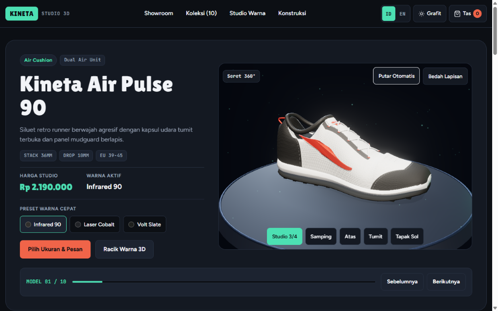
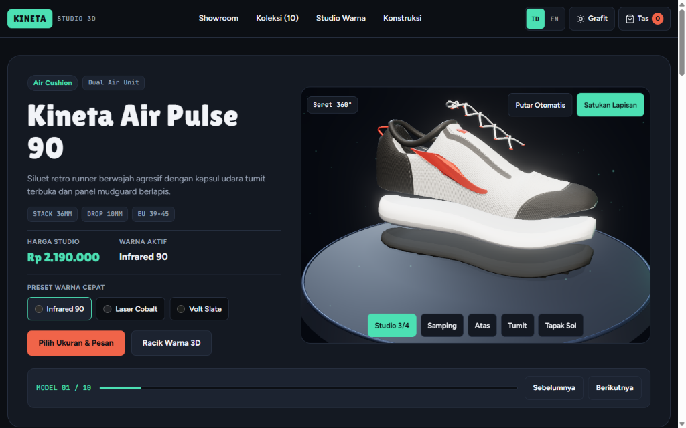
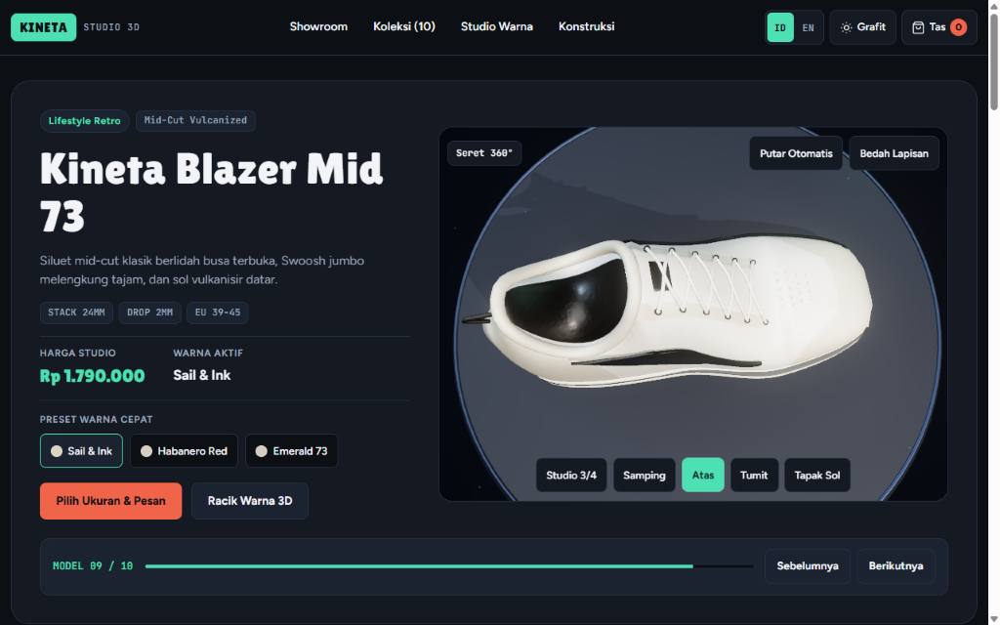
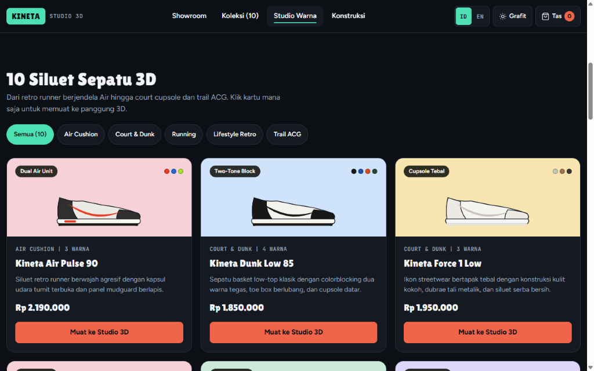
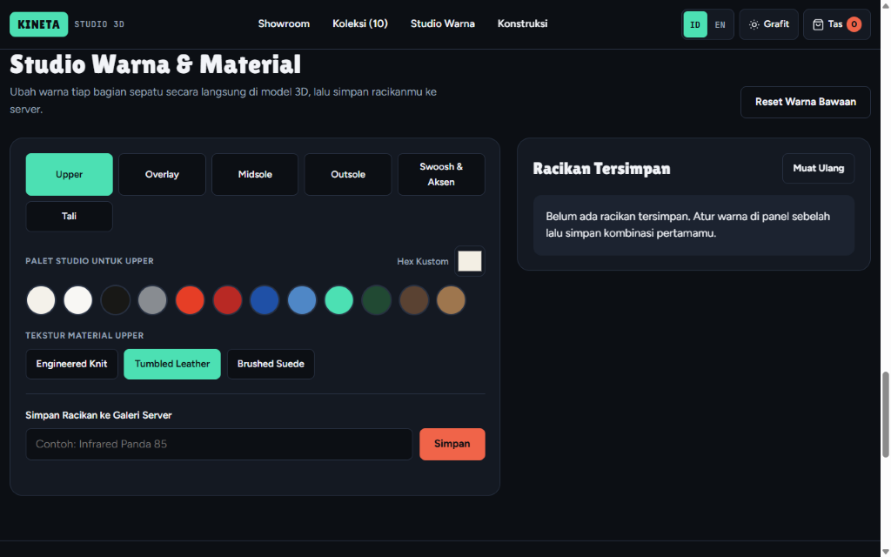
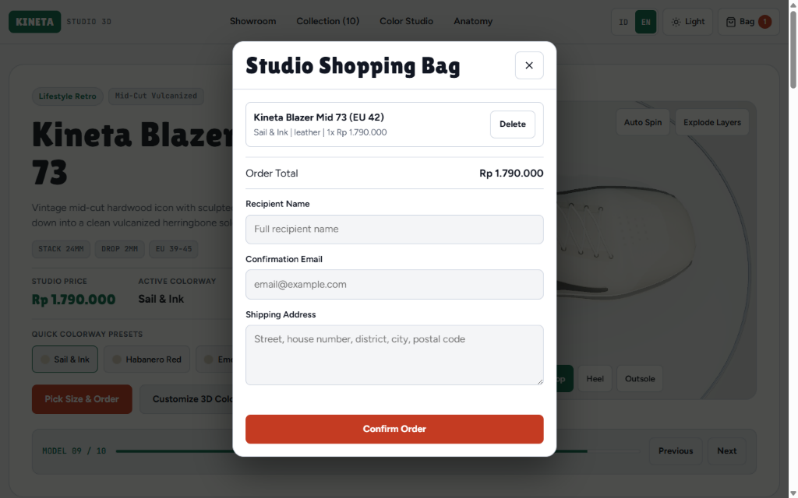
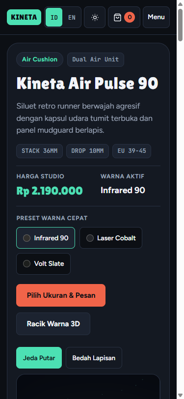

# Kineta Studio

Website showroom sepatu 3D interaktif dan studio kustomisasi warna berbasis **Node.js**, **Express**, dan **Three.js (WebGL)**.

**Kineta Studio** memungkinkan pengunjung menjelajahi 10 siluet sepatu 3D secara 360 derajat, membedah lapisan konstruksi (*Outsole*, *Midsole*, *Upper*, *Tali*), mengganti warna dan material permukaan secara real-time, menyimpan racikan warna ke server, memilih ukuran EU dengan cek stok langsung, serta melakukan pemesanan melalui modal tas belanja.

---

## Pratinjau Fitur & Screenshot

### 1. Showroom 3D Interaktif & Pencahayaan Studio PBR
Menampilkan sepatu 3D di atas panggung plinth dua lapis dengan *Softbox HDRI Environment*, postprocessing `EffectComposer` + `UnrealBloomPass`, bayangan lembut `PCFSoftShadowMap`, 5 sudut kamera (`Studio 3/4`, `Samping`, `Atas`, `Tumit`, `Tapak Sol`), kontrol jeda/putar otomatis, serta navigasi cepat `MODEL 01 / 10`.



### 2. Mode Bedah Lapisan (Exploded View)
Memisahkan komponen *Outsole*, *Midsole* (lengkap dengan jendela Air Unit transparan / cupsole welt), *Upper*, dan *Tali* secara vertikal untuk melihat konstruksi sepatu dari segala sudut.



### 3. Proporsi Lebar & Detail Bukaan Atas 3D
Geometri *last* sepatu yang proporsional dari tumit ke ujung kaki, bukaan pergelangan kaki berkerah empuk dengan rongga interior bergradasi, tekstur *normal map* prosedural, serta lengkungan Swoosh 3D yang menyatu dengan panel samping.



### 4. Katalog 10 Siluet Sepatu & Filter Kategori
Grid kartu koleksi berlatar panggung pastel dengan pratinjau siluet vektor sesuai colorway utama, filter 5 kategori (`Air Cushion`, `Court & Dunk`, `Running`, `Lifestyle Retro`, `Trail ACG`), serta panel pemilihan ukuran EU 39 sampai 45 dengan status stok real-time.



### 5. Studio Warna 6 Zona, Tekstur Material & Galeri Racikan
Kustomisasi warna untuk 6 bagian (*Upper*, *Overlay*, *Midsole*, *Outsole*, *Swoosh & Aksen*, *Tali*) melalui palet studio maupun hex picker kustom, pilihan material (*Engineered Knit*, *Tumbled Leather*, *Brushed Suede*), serta fitur simpan, pakai ulang, dan hapus racikan melalui API server.



### 6. Pilihan Bahasa `ID | EN`, Tema 3-Tingkat & Tas Belanja
Mendukung pergantian bahasa penuh **Indonesia / English (`ID | EN`)**, tiga pilihan tema (**Grafit**, **Obsidian**, dan **Terang**) yang sinkron dengan panggung 3D, serta modal tas belanja dengan validasi form dan konfirmasi pesanan dari server.



### 7. Tata Letak Responsif Seluler
Antarmuka menyesuaikan secara penuh pada layar ponsel (`375px` ke atas) tanpa horizontal overflow, dengan kontrol 3D yang tertata di luar kanvas agar tidak menutupi objek sepatu dan menu navigasi seluler yang mudah diakses.



---

## Daftar 10 Siluet Sepatu 3D

| No | Nama Model | Kategori | Karakter Konstruksi | Harga Studio |
| --- | --- | --- | --- | --- |
| 01 | **Kineta Air Pulse 90** | Air Cushion | Dual Air Unit tumit, mudguard berlapis | Rp 2.190.000 |
| 02 | **Kineta Dunk Low 85** | Court & Dunk | Two-tone colorblocking, cupsole datar | Rp 1.850.000 |
| 03 | **Kineta Force 1 Low** | Court & Dunk | Cupsole tebal, dubrae tali logam | Rp 1.950.000 |
| 04 | **Kineta Sky High 85** | Court & Dunk | High-top 6 eyelet, sayap kerah bertumpuk | Rp 2.490.000 |
| 05 | **Kineta Zoom Vapor Pro** | Running | Rocker stack tinggi 40 mm, Swoosh memanjang | Rp 2.650.000 |
| 06 | **Kineta Air 97 Wave** | Air Cushion | Garis gelombang upper, Air Unit memanjang penuh | Rp 2.550.000 |
| 07 | **Kineta React Infinity** | Running | Upper Flyknit satu lembar, klip stabilitas tumit | Rp 2.090.000 |
| 08 | **Kineta Waffle 77 Vintage** | Lifestyle Retro | Profil ramping retro, outsole gigi waffle | Rp 1.690.000 |
| 09 | **Kineta Blazer Mid 73** | Lifestyle Retro | Mid-cut klasik, sol vulkanisir herringbone | Rp 1.790.000 |
| 10 | **Kineta Terra ACG** | Trail ACG | Lug traksi dalam 5 mm, mudguard suede | Rp 2.390.000 |

---

## Arsitektur & Struktur Proyek

```text
kineta-studio/
├── server.js                 # Server Express 5, static serving, & REST API
├── package.json              # Konfigurasi Node.js (ESM) & skrip npm
├── .gitignore                # Aturan pengabaian file untuk Git
├── data/
│   ├── shoes.json            # Katalog 10 model sepatu, spesifikasi, colorway, & stok EU
│   ├── designs.json          # Penyimpanan racikan warna kustom pengguna
│   └── orders.json           # Riwayat pesanan yang tervalidasi server
├── public/
│   ├── index.html            # Halaman utama semantik + importmap Three.js lokal
│   ├── styles.css            # Design tokens (Grafit/Obsidian/Terang), animasi, & responsif
│   └── js/
│       ├── app.js            # State aplikasi, UI kustomisasi, katalog, & checkout
│       ├── i18n.js           # Kamus terjemahan penuh Indonesia & English
│       ├── studio-scene.js   # Scene 3D, softbox HDRI, EffectComposer, & OrbitControls
│       └── shoe-geometry.js  # Generator mesh sepatu 3D prosedural & normal map kanvas
├── docs/
│   └── screenshots/          # Dokumentasi visual fitur website
└── tests/
    └── api.test.js           # Pengujian integrasi REST API dengan node:test
```

Three.js disajikan langsung dari `node_modules/three` melalui endpoint `/vendor/three` sehingga seluruh aset dan modul 3D berjalan lokal tanpa ketergantungan CDN 3D eksternal.

---

## Dokumentasi REST API

| Method | Endpoint | Deskripsi |
| --- | --- | --- |
| `GET` | `/api/health` | Cek status layanan server (`{ ok: true, service: "kineta-studio" }`). |
| `GET` | `/api/shoes` | Mengambil seluruh katalog sepatu. Mendukung query `?category=...`. |
| `GET` | `/api/shoes/:id` | Mengambil detail spesifikasi, colorway, dan stok ukuran satu model. |
| `GET` | `/api/designs` | Mengambil daftar racikan warna kustom tersimpan. |
| `POST` | `/api/designs` | Validasi kode warna hex & simpan racikan kustom ke `data/designs.json`. |
| `DELETE` | `/api/designs/:id` | Menghapus racikan tersimpan berdasarkan ID. |
| `POST` | `/api/orders` | Memvalidasi keranjang, menghitung total harga di server, mengurangi stok EU, dan menyimpan pesanan ke `data/orders.json`. |

---

## Cara Menjalankan di Lokal

1. Pastikan **Node.js v20+** sudah terpasang.
2. Instal dependensi:
   ```bash
   npm install
   ```
3. Jalankan server:
   ```bash
   npm start
   ```
4. Buka `http://localhost:3000` di browser.

### Menjalankan Pengujian

```bash
npm test
```
git init
git add .
git commit -m "feat: build Kineta Studio 3D footwear customizer and showcase"
```
